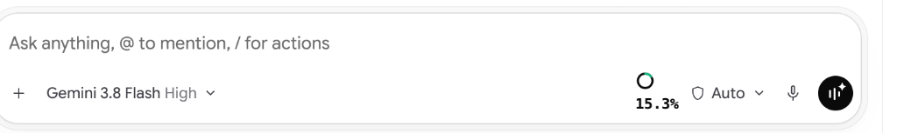
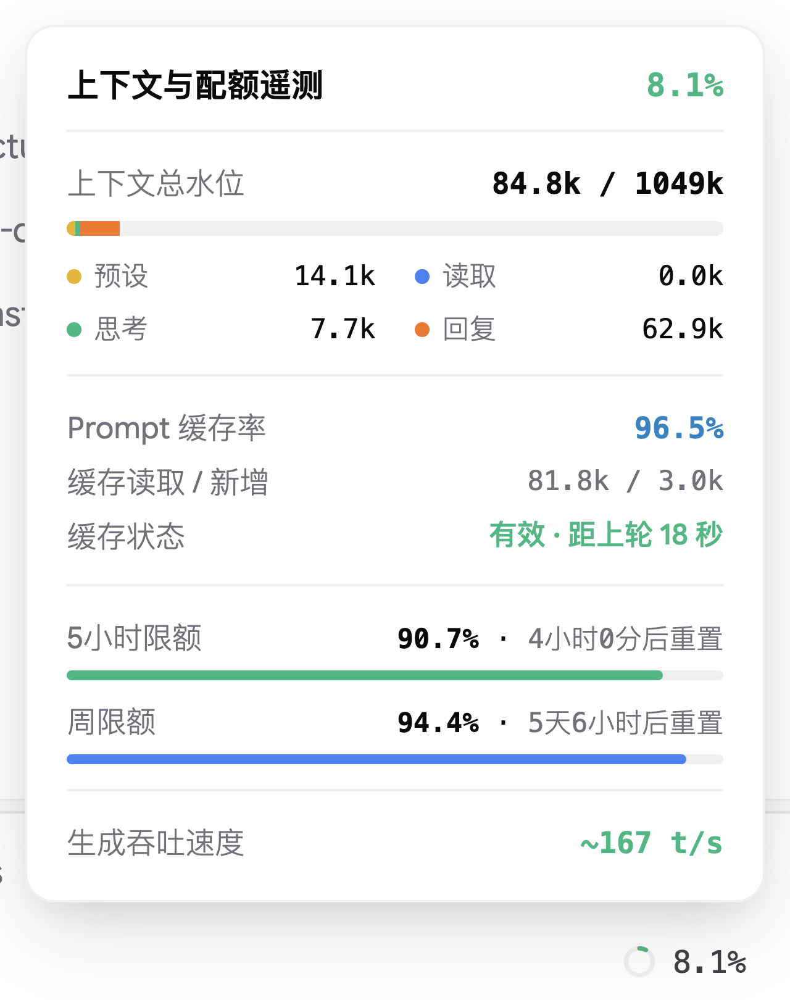

# Orbit · Context & Quota Telemetry (agy-orbit)

[中文文档](./README.md) | **English**

A seamless bottom-bar telemetry plugin designed specifically for **Google Antigravity**. Monitor real-time conversation context usage, 4-stage token breakdown, prompt cache validity countdown, and official account quota limits.

<p align="center">
  
</p>

<p align="center">
  
</p>

---

## Highlights

- **Inline Composer Footer Ring**: Mounts seamlessly to the left of the `Auto` button in the composer footer. Displays context percentage with dynamic status colors (green safe, amber warning, red critical).
- **Click to Toggle / Outside to Close**: Clicking the ring opens/closes the telemetry dashboard. Hover only provides subtle button feedback to prevent accidental popups; clicking outside automatically closes it.
- **Adaptive Context Window Limit**: While underlying models theoretically support larger windows, Antigravity assigns practical safe session limits (e.g. **256k** for Gemini, **160k** for Claude). Orbit dynamically reads the exact limit from Antigravity's native metadata and scales the progress bar proportionally:
  - **Preset (System/Init)**: Amber segment
  - **Read (Tools/Files)**: Blue segment
  - **Think (Chain of Thought)**: Green segment
  - **Output (Responses)**: Orange segment
- **2×2 Clean Legend Grid**: Structured dual-column grid prevents character wrapping, using monospace font for token metrics.
- **Prompt Cache Status Tracker**: Tracks cache hit rate (%) and cached vs new tokens. Accurately counts elapsed time since the previous model turn:
  - `< 180s`: `Valid · X s since last turn` (Green)
  - `180s ~ 240s`: `Expiring · X s remaining` (Amber warning to reuse warm cache)
  - `>= 240s`: `Expired · Cold start on next turn` (Gray)
- **Dual Official Quota Limits with Progress Bars**: Connects directly to Antigravity's internal LanguageServer RPC:
  - **5-Hour Quota**: Remaining fraction %, reset countdown, and dynamic progress bar.
  - **Weekly Quota**: Remaining fraction %, refresh countdown, and dynamic progress bar.
- **Generation Speed**: Real-time throughput calculation (`~XXX t/s`).
- **Cross-Platform CDP Watchdog & Native System Notification**: Includes shortcut patch scripts and parameters probe. Shows native OS notification if the debug port is not detected.
- **Native Dark/Light Theme Support**: Uses Antigravity host CSS variables (`--card`, `--foreground`, `--border`, `--secondary`), providing backdrop blur and zero hardcoded colors.
- **Zero Emojis & Clean Minimalist Design**: Professional technical vocabulary.

---

## Installation & Setup

### Method 1: Ask Your Agent to Install (Zero Effort, Cross-Platform)

No need to open a terminal. Simply copy and send the following prompt directly into your **Antigravity chat**, and the agent will install the plugin and automatically patch shortcuts on Windows:

```text
Please help me install the `agy-orbit` plugin:
1. Ensure the local plugin directory exists (`~/.gemini/config/plugins/` on macOS/Linux, or `$HOME\.gemini\config\plugins\` on Windows);
2. Clone `https://github.com/luluxiaoyu/agy-orbit.git` into the `agy-orbit` folder inside that directory (or run `git pull` if it already exists);
3. If on Windows, automatically run `powershell -ExecutionPolicy Bypass -File scripts\enable-cdp.ps1` from the plugin folder to patch desktop and start menu shortcuts with `--remote-debugging-port=0`;
4. Verify that the files (`plugin.json` and `sidecars/monitor/server.mjs`) are present, and remind me to confirm it is enabled in Antigravity Plugins settings.
```

---

### Method 2: System One-Click Installers

#### Windows Users
1. Download this repository and extract it;
2. Double click **`install.bat`**;
3. The script automatically installs the plugin into `%USERPROFILE%\.gemini\config\plugins\agy-orbit` and **automatically patches all Antigravity shortcuts on Desktop, Start Menu, and Taskbar** with `--remote-debugging-port=0`;
4. Quit Antigravity completely, then launch it from your desktop or start menu shortcut!

#### macOS / Linux Users
Run this one-liner in your terminal:
```bash
git clone https://github.com/luluxiaoyu/agy-orbit.git ~/.gemini/config/plugins/agy-orbit && sh ~/.gemini/config/plugins/agy-orbit/install.sh
```

> **macOS Launch Note**:
> On macOS, `install.sh` automatically builds a native **`Antigravity (CDP).app`** launcher in `/Applications` or `~/Applications` (with the official high-res icon and local codesign).
> Simply **drag `Antigravity (CDP)` to your Dock**, and click it whenever you launch Antigravity — no need to run terminal commands every time!
> 
> (You can also run the generator script directly: `sh ~/.gemini/config/plugins/agy-orbit/scripts/enable-cdp-mac.sh`)

---

## License

[MIT License](./LICENSE)
