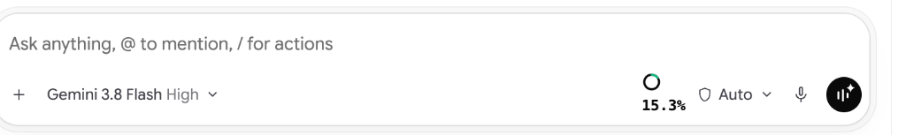
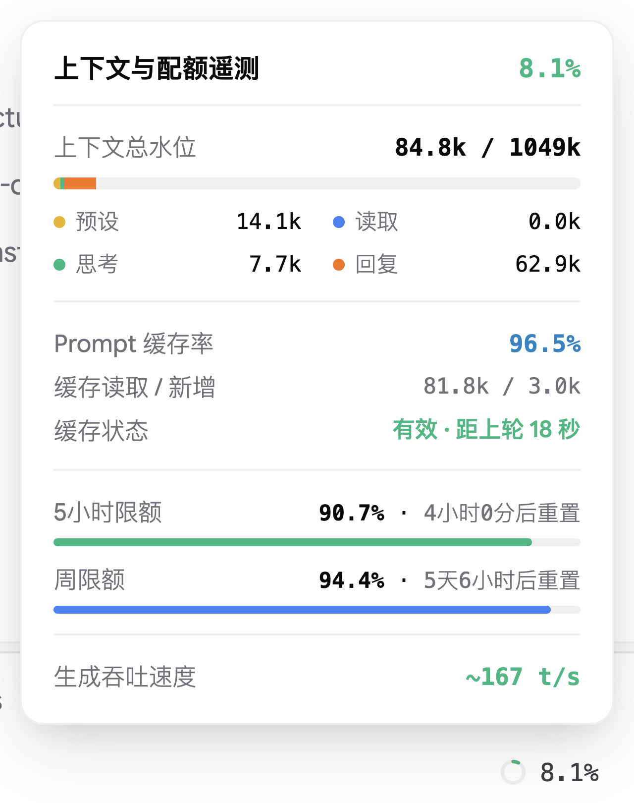

# Orbit · 上下文与配额遥测 (agy-orbit)

专为 **Google Antigravity** 打造的底栏无感遥测插件。实时掌控 1M 上下文水位、四段 Token 成分、Prompt 缓存时效与官方账户配额进度。

<p align="center">
  
</p>

<p align="center">
  
</p>

---

## 特性亮点

- **底栏极简内联圆环**：无缝挂载在输入框底栏 `Auto` 按钮左侧。实时呈现 1M 上下文占比，依据水位动态变换状态指示色（绿色安全、琥珀警示、红色临界）。
- **点击展开 / 外部收起**：严格遵循用户交互意图，点击圆环开关弹窗，鼠标悬停仅提供轻量底色反馈，绝不误触弹出；点击空白处自动收起。
- **104.9 万上下文比例标尺**：底槽真实代表 1M（1,048,576 Tokens）全局窗口，四段彩色滑块严格按实际占用水位紧凑排列，剩余为未占用底槽：
  - **预设 (系统/初始化)**：黄色滑块
  - **读取 (工具与文件)**：蓝色滑块
  - **思考 (推理链)**：绿色滑块
  - **回复 (生成输出)**：橙色滑块
- **2×2 清爽图例对齐**：采用双列网格排版，彻底解决汉字上下折行问题，数值使用等宽字体对齐展示。
- **Prompt 缓存状态追踪**：精准计算缓存命中率（%）与读取/新增 Token 数量；基于距上轮对话间隔动态追踪缓存有效性：
  - `< 180s`：`有效 · 距上轮 X 秒`（绿色）
  - `180s ~ 240s`：`即将失效 · 剩余 X 秒`（琥珀黄色预警，提醒趁热复用缓存）
  - `>= 240s`：`已失效 · 下一轮冷启动`（灰色）
- **官方账号限额双轨监控**：直连 Antigravity 后台 RPC 服务，实时读取官方配额并提供可视化进度条：
  - **5 小时限额**：剩余百分比、重置倒计时与专属水平动态进度条
  - **周限额**：本周累计剩余百分比、刷新周期与专属水平动态进度条
- **生成吞吐速率**：实时测量模型当前生成吐字速度（`~XXX t/s`）。
- **原生黑白主题自适应**：全面复用 Antigravity 宿主原生 CSS 变量（`--card`, `--foreground`, `--border`, `--secondary` 等），完美契合浅色与深色模式，毛玻璃质感底色。
- **无 Emoji 极简技术风格**：纯中文专业术语，界面克制干净。

---

## 安装方法

### 方法一：Git 一键安装（推荐）

打开终端，直接将仓库克隆至 Antigravity 插件目录即可：

#### macOS / Linux
```bash
git clone https://github.com/luluxiaoyu/agy-orbit.git ~/.gemini/config/plugins/agy-orbit
```

#### Windows (PowerShell)
```powershell
git clone https://github.com/luluxiaoyu/agy-orbit.git "$HOME\.gemini\config\plugins\agy-orbit"
```

---

### 方法二：手动安装

1. 点击本仓库右上角 **Code -> Download ZIP** 下载源码包并解压；
2. 将解压后的文件夹重命名为 `agy-orbit`；
3. 移动到对应系统的插件目录下：
   - **macOS / Linux**: `~/.gemini/config/plugins/agy-orbit`
   - **Windows**: `%USERPROFILE%\.gemini\config\plugins\agy-orbit`
4. 确保目录结构如下：
   ```text
   ~/.gemini/config/plugins/agy-orbit/
   ├── plugin.json
   ├── README.md
   ├── LICENSE
   └── sidecars/
       └── monitor/
           ├── package.json
           ├── sidecar.json
           └── server.mjs
   ```

---

## 启用与验证

1. **自动热加载**：安装完成后，Antigravity 通常会在几秒内自动识别并启动后台守护进程。输入框底栏即刻出现圆环胶囊。
2. **手动检查**：如未显示，可在 Antigravity 的 **Plugins（插件管理）** 界面中，确保 **Orbit · 上下文与配额遥测** 处于启用（Enabled）状态。
3. **点击交互**：点击底栏圆环即可展开完整遥测看板；再次点击或点击页面任意空白处即可收起。

---

## 技术原理

1. **Sidecar 守护机制**：通过 Antigravity 规范的后台 Sidecar 进程常驻运行，进程崩溃或客户端重启时自动拉起。
2. **CDP 动态挂载**：通过 Chrome DevTools Protocol 探针建立 WebSocket 链路，直接对客户端界面注入自愈型 DOM 节点，不修改 Antigravity 任何源码，升级客户端不影响使用。
3. **数据源层**：
   - **上下文与缓存遥测**：实时流式解析本地会话 Transcript 日志，精确计算 Token 分布与生成吞吐速度；
   - **账户额度**：通过本地通信通道直连官方 LanguageServer RPC 服务读取配额桶，无需任何 API Key。

---

## 开源协议

本项目采用 [MIT License](./LICENSE) 开源协议。
